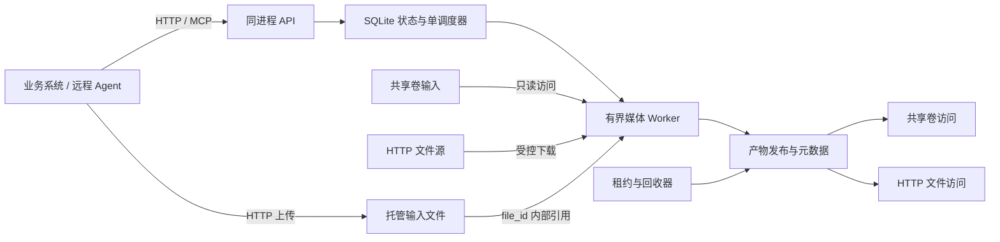

# 独立媒体服务首版设计

状态：设计基线，实施与验收状态见[实施进度](../plans/v1-implementation-progress.md)\
日期：2026-10-15\
目标项目：`ffmpeg-agent`\
配套文档：[技术选型](technology-selection-v1.md) · [六类能力参数化合同](media-parameters.md) · [实施计划](../plans/v1-implementation-plan.md)

本服务为不同语言、不同业务提供通用的离线媒体处理能力。业务通过 HTTP 或远程 MCP 提交任务，同机优先通过共享卷交接文件，跨机通过 HTTP 上传、HTTP 文件源和 HTTP 产物访问完成交接。服务管理托管输入、任务、中间文件和处理产物，业务系统管理自己的源文件与业务资产。

本文确定首版范围、接口语义、文件所有权、生命周期和部署方式，作为独立项目的实施依据。服务的公共协议、功能边界和技术选型不依赖特定调用方的框架、数据库或业务资产模型。

## 设计决策

| 决策 | 约定 |
| --- | --- |
| 公共接口 | HTTP JSON 与 OpenAPI，主版本路径为 `/v1`；远程 MCP 使用 `/mcp` 的 Streamable HTTP |
| 执行方式 | 所有媒体操作通过异步任务执行，提交后查询结果 |
| 同机文件交接 | 预先配置的共享卷，以存储标识和相对路径引用 |
| 跨机文件交接 | HTTP 先上传取得 `file_id`，或提交任务时上传；也支持 HTTP(S) 单文件源；结果提供 HTTP 访问 |
| 文件复用 | 托管上传文件通过 `file_id` 复用，已发布产物通过 `artifact_id` 作为后续任务输入 |
| 服务认证 | 一个可选服务 Token 统一保护 HTTP、MCP、上传和下载；未配置时开放访问 |
| 输出模型 | 单文件和文件集合，统一以产物管理 |
| 首版部署 | 单媒体节点、单容器、单 API 进程；容器内可配置 1～4 个逻辑 Worker |
| 状态存储 | SQLite 私有持久文件，不部署独立数据库服务；保留必要状态，不建历史库 |
| 计算与业务边界 | 服务处理媒体及交付产物，不管理业务附件关系或业务数据库 |
| 扩展方向 | 版本化操作、多个输入和步骤、可替换存储及执行器 |

共享卷与 HTTP 是文件访问方式，任务调用方式保持一致。共享卷省去应用层上传下载，不免除磁盘读写、解码或编码开销。跨机使用 HTTP 不要求业务服务中转已存在于对象存储中的文件。

## 首版范围

### 必须交付的能力

- 任务提交、幂等创建、状态查询、异步取消和重启恢复。
- `shared_file`、`http_file`、`uploaded_file`、`artifact` 四种输入引用。
- 独立 HTTP 上传取得 `file_id`，以及 multipart 请求内上传并持久提交异步任务。
- 远程 Streamable HTTP MCP，包含六个语义媒体工具与任务、文件、产物和租约管理工具。
- 命名输入、受控操作、有限无环步骤依赖、命名输出。
- 独立分支继续执行、失败依赖跳过和部分成功结果。
- 单文件及文件集合产物、共享卷访问和 HTTP 访问。
- 文件保留、读取租约、提前释放、后台回收和磁盘配额。
- 一个可选服务 Token、固定服务空间、配置的存储与 HTTP 来源访问策略及路径约束；兼容已有调用方配置。
- 固定版本的 FFmpeg/ffprobe 运行环境，以及操作能力查询。
- 同 Compose、跨 Compose 同 daemon、远端 HTTP 调用三种部署验收。

### 六类媒体操作与通用默认

| 操作标识 | 首版语义 | 输出端口 |
| --- | --- | --- |
| `media.probe.v1` | 提取格式、流、编码、时长、尺寸等规范化信息；未知字段允许为空 | `report`，JSON 单文件 |
| `video.transcode.v1` | 默认 H.264/MP4、保留源尺寸和帧时间；可调编码、尺寸、帧率、质量与音轨 | `video`，单文件 |
| `audio.transcode.v1` | 默认 AAC，采样率/声道/码率自动选择；可按需指定编码与规格 | `audio`，单文件 |
| `video.extract_audio.v1` | 选择音轨并提取或转换；无符合条件音轨时明确失败 | `audio`，单文件 |
| `video.extract_frames.v1` | 默认取首帧，可按时间点、间隔或数量抽帧，返回请求时间与实际媒体时间 | `frames`，文件集合 |
| `image.resize.v1` | 默认保留源尺寸转 JPEG，可按尺寸、适配策略与质量处理静态图片 | `image`，单文件 |

精确抽帧以归一化的视频播放时间轴为基准，默认采用“第一张时间不早于请求点的可解码帧”，也可选择之前或最近帧，返回 `requested_time_ms` 和 `actual_time_ms`。越界或无法命中的时间点返回逐项错误；存在可用帧时允许部分成功。自动旋转、起始时间归一化等细节须在该操作的 schema 和测试中明确，不以文件名或帧序号推算实际时间。

各操作的输入类型、输出端口、参数范围和预设列表通过 `capabilities` 提供。实施时需要先固化对应 JSON Schema；无法支持的编码组合、动态图片或参数必须明确拒绝，不能静默更换处理语义。

六个操作直接支持受控的编码、容器、尺寸、帧率、码率、采样率、质量、时间范围、抽帧策略和探测范围。`params` 可省略，使用通用默认；`preset` 默认为 `null`，已有三个具名预设作为可选快捷设置保留，显式参数覆盖所选预设。具体字段、默认及兼容关系见[参数合同](media-parameters.md)。

HTTP 与 MCP 复用同一参数模型，不需要额外选择参数版本。任务持久保存并安全公开有效参数，原始 source 不进入公开结果。能力查询列出六个 schema、通用默认、可选预设、可用软件编码器、容器兼容及部署限额；资源预算与媒体规格分开。

### 首版不包含的能力

以下保留扩展位置，但不作为首版完成条件：

- 本地 stdio MCP、stdio 桥接、各语言 SDK、Web 控制台和 webhook 通知。
- OAuth、用户身份、角色系统和多租户权限产品。
- 主动向第三方预签名 URL 上传产物，以及独立交付任务。
- NFS/NAS 部署、跨主机 Worker 调度、GPU 调度和多节点高可用。
- 通用脚本执行、任意 FFmpeg 命令透传、业务审批工作流。
- 视频拼接、字幕、水印、多码率与 HLS/DASH 生成等后续操作。
- 10-bit、HDR、色调映射/完整色彩转换，以及硬件编解码和设备资源管理；分别作为后续独立验收方向。
- 远端 HLS/DASH 等多资源输入导入、直播流和长期运行的流会话。
- 永久媒体资产库、全局内容去重、自动计算缓存及业务附件管理。

首版集合产物用于抽帧等场景；保留集合成员和入口字段，便于后续支持 HLS。保留模型不等于已经支持对应操作。

## 系统组成



- API 负责统一 Token 校验、请求校验、幂等、HTTP 上传、任务查询和产物访问；MCP 直接复用这些领域逻辑。
- 调度器负责持久队列、执行租约、并发和资源预算。
- Worker 负责获取输入、调用媒体引擎、校验输出和提交产物。
- 产物管理负责存储寻址、访问方式、集合清单及发布状态。
- 回收器只处理服务拥有的数据，按保留期和有效引用清理。

首版固定在一个容器、一个应用进程内运行 API、调度器、回收器与逻辑 Worker。`worker_concurrency` 默认 1，可配置为 1～4，重启生效；每个 Worker 一次执行一个任务，单任务内部串行执行步骤。不同任务的媒体子进程可以并行，全服务媒体子进程总数不超过 Worker 槽位数。不得将此配置用于 Uvicorn 多进程，也不拆分 Worker 容器。SQLite 仅串行处理短事务，不在事务中等待媒体或文件 I/O。内部职责保持独立，具体技术见配套选型文档。

## 文件引用与存储配置

### 共享文件引用

```json
{
  "kind": "shared_file",
  "storage_id": "project-a-input",
  "key": "batch-123/source.mp4"
}
```

`storage_id` 是预配置的逻辑存储名，不是客户端传入的任意 Docker 卷名。服务端配置需包含挂载根目录、读写角色、允许的调用方、容量限制及能够访问它的 Worker。

`key` 使用区域内的相对路径。调用方与 Worker 可以使用不同挂载路径；服务在自身环境中解析引用，拒绝绝对路径、目录越界、符号链接逃逸及非普通文件输入。路径检查与实际打开文件需使用不会被路径替换绕过的方式。

共享输入默认属于调用方，服务借用它并直接读取。提交任务不转移所有权，也不授权服务删除源文件。调用方必须保证提交后文件保持不变。只读挂载约束 Worker，不会阻止调用方自己覆盖或删除文件。仅凭路径无法检测所有同路径内容变化；调用方违反不可变约定时，服务不保证处理结果一致性。

如果业务不能保证借用期间的稳定性，可通过 HTTP 上传创建托管副本再引用 `file_id`。选择共享输入时仍要求调用方先准备稳定文件；共享卷的配置不会关闭 HTTP 上传、来源获取或产物下载。

### HTTP 文件引用

```json
{
  "kind": "http_file",
  "url": "https://files.example.com/source.mp4"
}
```

首版采用 GET 获取单文件，可携带受控的认证请求头。`expires_at` 是可选的获取期限提示，不是服务保证，也不替代实际响应检查。不要假定签名 GET 地址允许 HEAD 请求。

下载前校验来源策略，下载中执行实际字节上限、总时限和闲置超时。下载完成并通过必要检查后，生成服务持有的固定副本，同一任务的步骤和重试复用该副本。下载完成后的执行重试不重新读取可能变化的 URL。

来源 URL 要覆盖排队和下载窗口。到期或获取失败时，任务返回稳定错误码；首版不修改已接受任务的 URL，调用方可以使用新地址和新的幂等键提交新任务。

URL 不是内容身份。下载中断后的续传只有在能验证来源版本未变时才可使用，否则重新下载；首版不要求断点续传。引用可附带 `expected_size_bytes` 和 `expected_sha256`，提供后必须校验，不匹配时失败。

认证头和带签名的 URL 视作敏感信息，不进入公开查询、普通日志或错误信息；任务执行所需的敏感数据应受限保存并及时回收。

### 托管上传文件引用

```json
{
  "kind": "uploaded_file",
  "file_id": "file_0123456789abcdef0123456789abcdef"
}
```

`POST /v1/files` 流式接收单文件，基础内容类型为 `application/octet-stream`，完整落盘、计算字节数和 SHA-256 并持久登记后才返回 `file_id`。输入文件 ID 与输出 `artifact_id` 分开；原始客户端文件名不参与寻址，服务不公开私有路径。独立上传接口的 multipart 支持不属于该基础入口的必需行为。

上传文件存放在私有 `work_dir/_uploads` 区域，与每任务工作目录分开，不向业务挂载。默认保留期为完整上传后 24 小时，可配置；任务接受在同一事务中校验当前可引用状态并取得内部引用，保护排队、执行与自动重试。到期或显式 `release` 后停止新引用，已有任务继续使用，最后引用释放后才删除。

上传中断、大小超限、校验失败、持久接受失败和启动恢复都只能清理已登记的服务所有数据，不能按任意路径或扫全卷删除。上传接收不把大文件读入内存；认证在文件字节读取前完成，限制实际接收字节、并发、闲置时间、总时限及磁盘占用。

### 已有产物引用

```json
{
  "kind": "artifact",
  "artifact_id": "art_0123456789abcdef0123456789abcdef"
}
```

`artifact_id` 属于当前服务实例的数据域。API 校验调用方权限、产物可用状态和操作输入类型，并在接受任务时原子取得内部引用，防止排队期间被清理。

引用集合时，操作必须声明支持集合；也可通过可选 `member_key` 选择单个成员。首版不接受其他独立服务实例的裸 `artifact_id`，跨实例单文件通过 HTTP 引用。

## 任务接口契约

### 公共约定

- JSON 字段使用 `snake_case`，ID 为不透明字符串。
- 时间戳使用 UTC RFC 3339；媒体时间使用整数毫秒，文件大小使用字节。
- 简单模式的所有入口处于同一个服务空间，内部使用固定 `service_caller`，仅配置一个调用方时自动选定；不由请求体选择身份或授权范围。
- 显式配置 `service_token` 为 Token 时，HTTP、MCP、上传、元数据查询及下载统一要求 `Authorization: Bearer ...`；配置为 `null` 时开放这些入口。省略该字段则兼容原 `callers.tokens` 认证。Token 通过私有配置或容器 secret 提供，不进入 URL、工具参数或日志。跨宿主机使用 HTTPS 或受控加密入口。
- 简单 Token 模式不新增用户、角色或 OAuth 服务；既有调用方存储与来源规则继续作为部署配置。
- 未知操作、未知版本、不支持的参数和依赖环在创建阶段拒绝。
- 媒体损坏、来源不可达、下载后大小不符等执行期问题写入任务结果。
- 原始 FFmpeg stderr 仅可经脱敏后进入受控诊断日志，不直接成为公共错误消息。

### 主要接口

| 接口 | 结果与语义 |
| --- | --- |
| `GET /v1/capabilities` | 操作、输入类型、输出端口、参数 schema、预设版本和部署限制 |
| `POST /v1/files` | 单文件流式上传，完整持久登记后首次返回 `201` 和 `file_id`；有效保留期间同内容幂等重放返回 `200` |
| `GET /v1/files/{file_id}` | 托管输入元数据与可引用状态，不公开容器路径 |
| `POST /v1/files/{file_id}/release` | 幂等结束托管输入保留，停止新引用，等待已有任务释放 |
| `POST /v1/jobs` | 持久接受任务，首次创建返回 `202`、`job_id` 和 `Location` |
| `POST /v1/jobs/upload` | multipart 中先发送 `job` JSON，再发送命名文件；完整上传并持久接受后返回 `202` 和 `job_id` |
| `GET /v1/jobs/{job_id}` | 返回任务、步骤状态、阶段、错误、输入释放标志和产物引用 |
| `POST /v1/jobs/{job_id}/cancel` | 请求取消；非终态返回 `202`，已终态返回 `200` 与原终态 |
| `GET /v1/artifacts/{artifact_id}` | 返回元数据、集合摘要、成员清单入口、访问方式及保留期限 |
| `GET /v1/artifacts/{artifact_id}/members` | 分页返回集合成员与逐项结果，保持不可变清单顺序 |
| `GET /v1/artifacts/{artifact_id}/content` | 单文件流式访问，支持 HEAD 和 Range；集合不自动打包 |
| `GET /v1/artifacts/{artifact_id}/files/{member_key}` | 集合成员流式访问，支持 HEAD 和 Range |
| `POST /v1/artifacts/{artifact_id}/leases` | 申请读取租约，返回 `lease_id` 和 `expires_at` |
| `PATCH /v1/leases/{lease_id}` | 请求续期，返回实际生效的期限 |
| `DELETE /v1/leases/{lease_id}` | 幂等释放读取租约 |
| `PATCH /v1/artifacts/{artifact_id}/retention` | 在到期前申请延长保留期，返回实际 `retain_until` |
| `POST /v1/artifacts/{artifact_id}/release` | 幂等请求提前结束保留，不强制中断有效读取 |

`202` 只说明请求已持久接受，实际处理可能失败。任务创建、幂等记录和托管上传文件/已有输入产物的引用获取应作为一个一致性操作提交；资源不足或持久化失败时不能先返回接受成功。HTTP `202` 的定义见 [RFC 9110](https://www.rfc-editor.org/rfc/rfc9110.html#name-202-accepted)。

### 请求内上传

`POST /v1/jobs/upload` 使用 `multipart/form-data`。第一个 part 必须为名为 `job` 的 JSON 元数据；需要上传的输入在该 JSON 中使用 `{"kind":"upload","part":"source"}` 占位。`part` 必须与输入名相同，后续同名文件 part 与占位一一绑定，拒绝缺失、重复或未声明的文件 part；文件可以与已有 `uploaded_file`、共享文件、HTTP 来源及产物引用混用。`upload` 只用于该入口，不是普通 JSON 任务可接受的输入类型。

两种上传入口共用托管文件、预算、幂等与清理逻辑。未完整上传的文件关闭后进入回收；请求内上传已完成但任务尚未接受时，文件仍按上传 TTL 有界保留，供同提交键重试复用，届满定向回收。请求内上传完成后将占位绑定为服务生成的 `file_id`，然后持久接受任务；不在本次 HTTP 请求中等待媒体执行。响应丢失后重试必须能返回原任务，不能因重传文件产生重复处理；完整文件内容摘要参与请求内上传的幂等判定。

### 远程 MCP

`/mcp` 在同一 FastAPI 进程内提供 Streamable HTTP，不启动独立 Worker、数据库或消息队列。只支持远程调用，不提供本地 stdio 或文件路径桥接。MCP 工具调用与 HTTP 任务使用同一接受、幂等、取消、恢复、发布及回收逻辑。

六个语义媒体工具分别对应 probe、视频转码、音频转码、提取音频、抽帧和图片缩放，直接映射到六个 `.v1` 操作。各工具的 `params` 可省略，以通用默认完成处理；需要定制时使用与 HTTP 相同的参数。通用工具覆盖能力查询、任务图提交、任务查询/取消、上传文件元数据/release、产物元数据/成员、保留/release 和租约申请/续期/释放。媒体工具短请求接受任务并返回 `job_id`，结果通过查询返回结构化状态、稳定错误码、`artifact_id` 和 HTTP 访问方式。

MCP 的 HTTP 传输承载协议消息；文件字节通过独立 HTTP 上传下载，不放进工具参数或 base64 结果。远程 Agent 只能引用 `file_id`、受控 HTTP 来源、配置的共享存储或已发布产物，不能提交客户端本地路径让容器读取。客户端须能为 MCP 和文件 HTTP 请求配置同一个 Bearer Token，返回的下载 URL 不包含 Token。

### 创建任务示例

```json
{
  "inputs": {
    "main": {
      "kind": "shared_file",
      "storage_id": "project-a-input",
      "key": "batch-123/source.mp4"
    }
  },
  "steps": [
    {
      "id": "preview",
      "operation": "video.transcode.v1",
      "inputs": {"video": {"source": "main"}},
      "params": {"preset": "web_720p_v1"}
    },
    {
      "id": "cover",
      "operation": "video.extract_frames.v1",
      "inputs": {"video": {"source": "main"}},
      "params": {"sampling": {"mode": "timestamps", "timestamps_ms": [1000]}}
    }
  ],
  "outputs": {
    "preview": {"step": "preview", "output": "video"},
    "cover": {"step": "cover", "output": "frames"}
  },
  "output_policy": {
    "storage_id": "project-a-output",
    "retention_seconds": 86400
  }
}
```

步骤输入绑定使用 `{"source":"输入名"}` 或 `{"step":"步骤名","output":"输出端口"}`。步骤构成无环图，首版对步骤数、依赖深度和输出数量设置上限，不支持循环或运行任意脚本。

`outputs` 声明需要对外保留的命名输出；未声明的中间结果仅供本任务使用。首版要求每个步骤都为至少一个声明输出提供结果或依赖，拒绝无用途步骤。

`output_policy.storage_id` 可省略，使用调用方配置的默认输出区；指定时必须具有写入授权。产物 key 由服务生成，调用方不能选择任意覆盖路径。`retention_seconds` 从正式发布时开始计算，创建时校验其是否处于部署允许范围，不能静默缩短已接受的保留承诺。

本例显式选择可选预设和 1 秒抽帧点；去掉对应 params 即使用通用默认。一天保留期用于说明请求结构，实际预设和部署限额由 `capabilities` 公布，验收证据另行记录。

### 幂等与版本

创建任务必须支持调用方作用域内的 `Idempotency-Key`。同一 key 和相同规范化请求返回原 `job_id`，重放返回 `200` 与当前状态；同一 key 配不同请求返回 `409 IDEMPOTENCY_CONFLICT`。

首版将敏感输入字段也纳入请求一致性判定，但不明文保存到幂等日志。刷新 URL 属于请求变化。幂等记录至少保留到任务终态之后的约定重试窗口；首版默认窗口为终态后至少 24 小时，实际到期时间随响应声明。窗口内保留可查询的最小任务记录；超过窗口不能保证仍返回原任务，不以幂等为由建设长期历史库。

幂等创建不等于媒体内容去重，也不自动重新运行失败任务。重新执行使用新任务和新 key。

任务接受时冻结操作版本、预设内容及执行版本要求。升级后仍需使用兼容该要求的执行环境处理已排队任务，否则明确失败；不能悄悄套用新预设。记录实际引擎版本和镜像版本以便诊断，不承诺不同引擎构建产生逐字节一致的媒体。

### 错误语义

错误结构包含 `code`、脱敏 `message`、`retryable` 和 `request_id`；步骤失败还包含步骤 ID。`retryable` 表示在原因消除后可重新尝试，不意味着立即无限重试。

| HTTP 状态 | 使用场景 |
| --- | --- |
| `400` | JSON、multipart 或基本请求格式错误 |
| `408` | 上传闲置或总时限到期 |
| `401` / `403` | 身份认证或作用域授权失败 |
| `404` | 不存在或不向当前身份公开的资源 |
| `409` | 幂等冲突、资源状态冲突 |
| `410` | 已授权资源保留记录仍在，但产物已结束保留且无可用租约，或上传输入已结束保留 |
| `413` | 请求体超过 API 限制 |
| `422` | 不支持的操作、参数、输入类型或步骤依赖 |
| `429` | 调用方配额或队列容量达到上限 |
| `503` | 服务暂不可接受任务 |

创建成功后的执行失败通过任务查询返回，查询本身仍可为 `200`。公共错误码至少覆盖来源不可达、输入变化或校验失败、媒体无效、操作不支持、任务超时、磁盘不足和执行中断。仅凭来源返回 `403` 不能断言 URL 已过期。

## 执行状态与恢复

任务状态为 `queued`、`running`、`canceling`、`succeeded`、`partial`、`failed`、`canceled`。`running` 内用 `phase` 表示 `acquiring_inputs`、`processing` 或 `publishing`。无法可靠计算进度百分比时返回空值和阶段信息。

首版执行独立分支继续策略：某步骤失败时，其依赖方标为 `skipped`，独立分支可继续。下游默认不消费部分成功结果，仅操作显式声明支持部分输入时例外；否则将该依赖视作未满足。按声明输出判定终态：全部成功为 `succeeded`，部分可用或某输出为部分成功为 `partial`，没有可用输出为 `failed`。所有终态都返回逐项结果，不能只靠产物列表推断失败原因。

取消请求先持久化取消意图并进入 `canceling`。Worker 停止后续步骤，终止并回收相关子进程，关闭输入与工作文件，再原子提交终态、`inputs_released` 和内部输入引用释放。正常完成与失败收尾也遵守这一一致性约束。排队任务可以直接完成收尾。持久化取消意图的任务在重启后只能继续取消收尾，不能重新执行媒体操作。成功提交终态后，取消请求不改写终态。

取消前已经完整发布的产物仍按保留策略可用；未发布结果不可消费。`canceled` 不等于自动删除全部输出。终态必须明确返回 `inputs_released=true`，表示本任务及其自动重试不会再使用借用输入。

SQLite 持久保存必要的任务定义、状态、执行尝试、产物清单、引用和短期幂等记录。运行中任务使用有限期执行租约与尝试编号保护提交资格。应用不可恢复故障时退出整个容器，禁止容器内热重启接管；恢复前确认上一轮受管进程已由关闭流程或容器运行时终止，再撤销遗留执行的发布资格，按来源可用性、重试预算和失败类型重新排队。不能确认执行者停止时保持不就绪。租约过期本身不证明进程已经停止，确认其退出前不得释放借用输入或清理它正在使用的文件。每次尝试使用独立目录，只有当前有效执行者能够提交正式结果，过期执行者不得覆盖新结果。

步骤完成与产物发布建立持久检查点。一旦输出绑定到已发布的 `artifact_id`，其内容、成员清单和任务输出绑定均不可被自动重试替换。恢复时复用已完成步骤，只重试尚未提交的部分，并为仍会使用的产物保持内部引用。已发布的部分结果集合也不在原地补写；需要重做时创建新任务。无法从现有检查点安全恢复时明确失败，不以重跑覆盖已经被消费的结果。

网络获取可做有界退避重试，确定性媒体错误不自动重试。任务总时限包括排队、获取输入、全部步骤和发布，不能仅给每条 FFmpeg 命令设置超时。具体时限、重试次数与并发是部署配置，并通过能力接口声明。

## 产物契约

产物具有不透明 `artifact_id`、所属调用方与任务、输出名、`kind`、媒体元数据、文件大小、完整性信息、发布状态、`retain_until` 和访问方式。首版 `kind` 为 `file` 或 `collection`。

访问方式可以同时包含共享存储引用与 HTTP 端点。共享位置只返回给有权访问相应区域的调用方；容器是否实际挂载该区域仍由部署配置保证。HTTP 下载与其他入口使用统一可选 Token，查询接口和下载 URL 不回显来源凭据或服务 Token。

集合包含成员清单、相对路径、每项媒体信息及可选入口成员。抽帧集合的清单还包含请求时间、实际时间和逐项错误。允许部分成功的操作可以发布一个自洽的部分结果集合：成功成员全部存在，失败项明确记录，不能引用尚未发布或缺失的文件。

集合清单通过独立的分页成员接口返回，任务及产物元数据只返回摘要与入口，避免返回海量成员。访问任意成员均需集合授权，禁止通过成员路径越界。

首版不为集合自动生成 ZIP。未来增加 HLS 时，需要约束清单及分片的整体完整性，并提供覆盖所有成员的访问授权；只签名入口播放列表是不完整的交付。首版不宣称支持媒体播放器直接消费 HLS。

## 文件生命周期

### 所有权与交接

| 数据 | 所有者 | 保留责任 | 清理责任 |
| --- | --- | --- | --- |
| 共享输入 | 调用方 | 提交后保持不变，直到 `inputs_released=true` | 调用方 |
| HTTP 来源原文件 | 来源提供方 | 在获取阶段提供稳定、可访问的内容 | 来源提供方 |
| HTTP 下载副本 | 服务 | 覆盖当前任务及其自动重试 | 服务 |
| HTTP 托管上传文件 | 服务 | 覆盖上传保留期和已接受任务的内部引用 | 服务 |
| 中间文件和未发布输出 | 服务 | 覆盖步骤依赖、执行与恢复需要 | 服务 |
| 已发布产物 | 服务 | 覆盖承诺保留期和有效引用 | 服务 |
| 任务与产物保留记录 | 服务 | 覆盖查询、幂等和诊断窗口 | 服务 |

共享输入的正常交接顺序是：调用方写临时文件，关闭文件，在同一文件系统内重命名发布，再提交任务。任务进入 `running` 不意味着输入可删除；首版统一等到终态且 `inputs_released=true`。该保留承诺由调用方执行，服务无法通过内部租约强制保护调用方目录。

产物先写入私有工作目录，校验并完成必要的文件/目录同步后发布。大文件复制、校验和同步不能阻塞唯一的 API 事件循环；取消时必须等待已启动的文件操作停止并关闭句柄，再释放引用和清理相关文件。若工作区与输出区不在同一文件系统，先复制到输出区的暂存位置，再执行该文件系统内的发布。集合最后发布清单。仅当文件和元数据均可用后，API 才宣布产物为 `ready`。

文件系统和任务库不能天然组成同一事务，因此需要可恢复的发布状态：崩溃后的已落盘但未登记文件按任务尝试记录核对，完成提交或定向回收；不能仅凭目录存在就判定成功。

### 保留期与租约

三个时间含义独立：

- `retain_until`：服务承诺接受新消费和新任务引用的截止时间。
- 访问凭据有效期：某个 HTTP 链接或令牌的访问期限，不决定产物是否仍存在。
- 物理删除时间：产物结束保留且无有效引用后，回收器实际删除的时间。

读取租约是一项有截止时间的保留承诺。共享卷消费者必须在开始读取前申请租约，完成后释放；共享文件读写不经过 API，服务无法自动观察消费者是否仍在使用文件。

首版采用以下一致规则：

1. `ready` 且尚未超过 `retain_until` 的产物可以申请新的读取租约或成为新任务输入。
2. 服务接受后续任务时自动取得内部引用，覆盖排队、执行和自动重试；调用方无需为该任务另建读取租约。
3. HTTP 单次文件响应开始前自动取得有界读取引用，流结束后释放；达到传输总时限时先终止流并关闭文件，再释放引用。自动引用的到期回收必须经过响应执行者停止确认，不能仅按时间删除仍在发送的数据；执行者崩溃时由恢复流程确认停止后回收。跨请求、Range 重试或集合消费需要显式租约。
4. 显式租约可通过受限 `X-Artifact-Lease-Id` 请求头用于 HTTP 读取；租约仍需与调用方身份和目标产物匹配，不是通用访问凭据。产物进入 retiring 后，该租约也可用于获取相应元数据和成员清单。
5. 到期或 `release` 后，产物进入 `retiring`，停止新消费和新任务引用，已取得的有效引用继续受保护。
6. 有效租约只能在租约本身未到期、产物未进入 `retiring` 时续期。单次和累计期限受部署上限约束。
7. 需要更久保留时，在 `retain_until` 之前申请延长保留期；已进入 `retiring` 的产物不重新激活。
8. 没有有效引用后才进入删除流程。租约取得、续期、状态变更和回收资格判定必须互斥，防止申请成功后立即删文件。

首版建议默认产物保留 24 小时、单次读取租约 15 分钟；这些是可配置的起始值，需结合文件大小和并发验证。租约可能延伸到 `retain_until` 之后，但到期保留状态下不再续租。调用方应按服务返回的实际期限消费和续期，不能将建议值硬编码为契约。

共享卷输入不属于上述服务产物租约体系。产物租约也无法阻止具有卷写权限的外部程序删除文件，因此业务对输出区域应只读挂载，清理由服务负责。

### 回收与异常残留

服务清理必须按托管上传文件、任务、执行尝试和产物记录定向进行，禁止递归清理调用方输入区域。失败或取消后，先确认执行停止，再清理不再需要的中间文件。托管上传区与任务目录分开，删除一个任务的工作目录不能影响其他任务引用的 `file_id`。

后台回收器按配置周期处理到期托管输入、到期产物、过期引用及崩溃遗留的已登记暂存数据，启动恢复也执行核对，清理操作需幂等。默认扫描间隔 10 秒；到期时间是新引用资格的边界，不是立即物理删除的承诺。磁盘不足时限制接收上传/新任务或明确失败，不能为腾空间删除仍处于承诺保留期或有效引用中的文件。

首版不建设历史任务库。活动任务、可用产物和有效引用所需元数据必须保留；终态后尽早删除不再需要的来源认证信息与详细执行材料。最小任务记录保留到幂等保证窗口结束、所属产物及引用全部回收之后，再定向清理；清除后查询可返回 `404`，不要求永久墓碑。幂等记录仍有效时，其返回的任务必须可查询。默认保证窗口为终态后至少 24 小时，不能为了“不保留历史”破坏恢复和保留承诺。

## 部署方式

### 同一个 Compose

业务和媒体服务使用同一 Docker daemon 中的命名卷。建议每个项目分开输入区和输出区：业务输入读写、Worker 输入只读、Worker 输出读写、业务输出只读。

业务应直接把待处理文件生成到输入卷，避免先写容器私有层再额外复制。Worker 的暂存目录独立于业务卷，不向业务暴露。任务 HTTP 通过 Compose 网络访问服务。

### 跨 Compose 同宿主机

由部署管理方预建共享卷，相关 Compose 使用 `external: true` 和明确的实际 `name` 引用。不要依赖不同 Compose 中相同的逻辑卷名，它们可能落到不同项目作用域。

需要调用 API 的容器加入预建的 external network，或使用受控的服务入口。仅暴露必要服务，不要求各业务数据库加入共享网络。

命名卷按 Docker daemon 的存储环境管理。相同物理宿主机上的不同 daemon、rootless 实例或虚拟机，不能仅凭卷名相同假定共享。Docker Desktop 中也应核实实际运行环境。

宿主机程序需要访问文件时，可将相同受控目录分别 bind mount 到容器；这会引入宿主机目录约定。卷的生命周期与临时文件生命周期分开，删除 Compose 应用不应成为清理共享卷的手段。

Docker 的只读及多容器挂载行为见 [Volumes](https://docs.docker.com/engine/storage/volumes/#use-a-read-only-volume)，外部卷命名与生命周期见 [Compose volumes](https://docs.docker.com/reference/compose-file/volumes/)，跨项目连通方式见 [Compose networking](https://docs.docker.com/compose/how-tos/networking/#use-an-existing-external-network)。

### 跨宿主机

首版保持单个媒体节点，远端业务可直接 HTTP 上传取得 `file_id`、请求内上传并提交任务，或提交 HTTP 文件源；通过 HTTP 或 MCP 创建和查询任务。Worker 处理后将产物放入服务输出存储，远端调用方通过 HTTP 消费。

源地址必须从媒体节点可达，返回的访问入口必须从调用方可达，不能返回仅容器内部可解析的服务名。通过部署配置提供对外访问基址和认证方式。

源文件已在 OSS、其他对象存储或文件服务时直接使用其 HTTP 地址；仅存在远端业务本地时可直接上传。首版不提供任意远端路径访问；MCP 请求中也不能把客户端路径当成容器内路径。

两台宿主机的同名普通本地卷不会同步。NFS、网络卷驱动或每节点就近 Worker 是后续部署扩展，不属于首版依赖。

### 持久化与单节点边界

任务状态、产物、工作文件使用明确的持久区域。首版选用 SQLite 文件兼任状态库与持久队列，不部署独立数据库或消息中间件。数据库位于服务私有本地持久卷，业务容器不挂载，不使用 NFS，不允许多个应用实例共享；单实例锁和统一短事务入口保护幂等、引用与状态一致性。

API、调度器和 Worker 均在本容器，Worker 并发与每个媒体子进程的线程预算分别配置，受容器 CPU、内存、PID 和存储限制。服务提供健康与就绪检查；启动时校验数据库、FFmpeg/ffprobe/Pillow、预设所需编解码器、配置挂载点及可用空间，完成恢复后才就绪。

容器重启可按持久状态恢复，不代表宿主机磁盘损坏后仍能恢复产物。首版不提供跨机高可用。未来多节点扩展时，必须引入存储可达性调度及适用的产物访问路由，不能将本地文件任务随机分派。

## 运行约束

- 对调用方、队列、Worker 和存储分别设置配额。限制输入实际字节数、媒体时长、像素规模、步骤数、抽帧数量、产物数量、输出总量和临时磁盘占用。
- FFmpeg 子进程应可实际取消并回收；协程取消不能被当成进程已停止。使用结构化参数生成命令，不开放任意 shell 执行。
- HTTP 来源限定为授权的 HTTP(S) 目标。内部文件服务通过配置放行，检查 DNS 解析和重定向，避免变成任意网络访问代理。
- Worker 只访问已取得且获准的输入，限制媒体内部引用的外部资源。下载一个文件不代表解析过程不会继续读取其他资源。
- 来源获取有连接、闲置和总时限；任务有总执行预算；重试次数有上限。限流和瞬时故障可以重试，损坏媒体或非法参数不自动重试。
- 日志使用请求、任务、步骤和执行尝试 ID 关联，记录耗时、错误码与资源统计，隐藏签名 URL、认证头和敏感绝对路径。
- 记录排队时间、下载时间、媒体执行时间、发布耗时、失败原因、磁盘用量和租约占用，以便确定扩容依据。

## 实施顺序与验收

### 建议实施顺序

1. P0 固化公共 schema、预设、运行基线，并准备测试素材。
2. P1～P3 打通单容器 SQLite 控制面、可配置 Worker、安全执行器及 probe 产物闭环。
3. P4/P5 补齐其余操作、组合步骤和部分成功，以及取消、恢复、租约和回收。
4. P6 接入受控 HTTP 来源和产物访问，覆盖实际响应发送的引用保护。
5. P7 完成故障、并发资源、三种部署方式及端到端验收。
6. P8 固定可选统一 Token、托管上传和远程 MCP 的增量合同，保留 P0～P7 的既有证据。
7. P9/P10 完成托管上传生命周期及请求内上传；P11 接入同进程远程 MCP。
8. P12 完成新增文件通路、Token 开关、MCP 协议与真实媒体容器闭环验收；实际两宿主机环境仍独立补验。
9. P13 冻结六类能力的单一参数合同、共享模型、通用默认与能力发现；P14/P15 实现音视频及图片/抽帧/探测。
10. P16 对齐 HTTP/MCP 参数与使用文档；P17 以真实媒体和精确镜像完成增量验收，保留既有证据与未验证的外部条件。

每一步产出的代码和配置在新项目中独立维护。操作实现可以复用已有经验，但必须以本服务契约进行验证。

### 首版验收条件

| 场景 | 必须验证的结果 |
| --- | --- |
| 同 Compose 共享卷 | 调用方写入后直接处理，任务仅传引用；产物可在输出卷读取 |
| 跨 Compose | 两项目引用同一个外部卷；不同容器挂载路径不影响引用 |
| 跨宿主机 | 实际远端客户端通过 HTTP 源提交并通过 HTTP 消费结果，不依赖共享目录 |
| 输入交接 | 输入发布完成后才提交任务；缺失及校验可检测的变化明确失败；服务不删除借用源文件 |
| 幂等与并发 | 相同 key 只创建一个任务；不同请求冲突；接受操作不会漏掉产物引用；Worker 1/2/4 的进程上限有效 |
| 组合步骤 | 上游输出可作下游输入，失败依赖跳过，独立分支可成功 |
| 真实媒体 | 使用真实 FFmpeg/ffprobe 和 Pillow 验证格式、尺寸、音轨、实际帧时间及图片方向 |
| 集合结果 | 清单与已发布成员一致，部分抽帧失败可定位到请求项 |
| 取消 | 子进程实际停止，输入释放标志正确，未发布文件不可被消费 |
| 重启与重试 | 排队任务可恢复，取消意图不丢失，已发布输出绑定不变，过期执行者不能覆盖新结果 |
| 文件回收 | 运行中任务与有效租约保护文件；到期后拒绝新引用，最后引用释放后回收 |
| 租约竞争 | 申请、续期与清理竞争不会返回已被删除文件的有效租约 |
| HTTP 访问 | 大文件流式输出、HEAD、Range、断开和权限失败符合契约 |
| 独立上传 | 流式接收后取得可复用 `file_id`；大小/摘要可核对，断流和恢复不留下可消费半文件 |
| 请求内上传 | JSON 元数据先于文件，命名绑定严格；接受后异步执行，重放不产生重复任务 |
| 托管输入回收 | 未引用文件到期可回收；排队/运行/自动重试引用保护文件，release 不打断已有任务 |
| 远程 MCP | 真实客户端初始化、发现工具、提交/查询/取消，并通过 HTTP 上传下载完成媒体闭环 |
| 可选 Token | 开放模式与单 Token 模式分别验证；HTTP、MCP、上传和下载一致校验，凭据不进入 URL/工具参数/日志 |
| 越界与泄漏 | 路径越界、符号链接逃逸、非法 URL 目标被拒绝；响应不泄漏凭据 |
| 资源上限 | 队列满、超大输入、超时和磁盘不足可控失败，不破坏其他任务产物 |

跨宿主机未在两台实际主机验证前，不能仅凭同机两个容器宣称通过该项验收。数据清理测试只操作本用例登记的上传文件、任务和产物，不执行全库或全卷清空。

### 技术选择与实施入口

[技术选型](technology-selection-v1.md)已确定 Python/FastAPI、SQLite、单容器可配置 Worker、媒体引擎和默认配置基线；[实施计划](../plans/v1-implementation-plan.md)保留 P0～P12 并新增 P13～P17；[参数合同](media-parameters.md)定义六类能力的通用默认与可调范围。当前六个基础媒体由本仓库脚本生成，方法、媒体属性和摘要见 [fixture 说明](../../tests/fixtures/README.md)；本次迁移前的验收仍绑定原复制素材，不追溯改写。

实施先冻结操作 schema、时间/画面语义、预设、实际依赖与镜像版本，再完成真实媒体和容量验证。本文记录设计基线，不代表验收通过；已实现、已验证和未验证项以[实施进度](../plans/v1-implementation-progress.md)中的实际证据为准。
